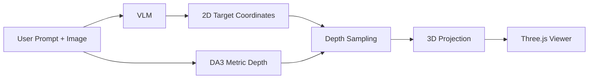

# Apollo Spatial VLM


A VLM picks targets in an image, a depth model (Depth Anything 3 or MoGe-3) estimates metric depth, and the demo lifts the targets into a 3D point cloud and Gaussian splats you can inspect in the browser. Above: "locate the Sydney Opera House" with Qwen3.6-27B-FP8 and DA3 on an RTX PRO 6000 Blackwell (2 s per request), then the view tilted left and right. The same app also runs entirely on an NVIDIA Jetson AGX Orin 64 GB (about 5 s per request with Molmo2-8B and DA3).

## Origin

Apollo Spatial VLM is inspired by, and continues, [MercuriusTech/Odyseus-Spatial-VLM](https://github.com/MercuriusTech/Odyseus-Spatial-VLM), a demo by Mercurius Technologies for their Odyseus spatial-intelligence product. It started as a fork of that repository and was renamed on 2026-10-14 (to track it: `git remote add upstream https://github.com/MercuriusTech/Odyseus-Spatial-VLM.git`). Mercurius hosts their own live demo at [app.odyseus.xyz](https://app.odyseus.xyz).

On top of the original (VLM + Depth Anything 3 + a Three.js point cloud), this continuation adds:
- Gaussian splats built in the browser from the depth grid (Spark), next to the point cloud.
- Model options in the page: DA3 or MoGe-3 (ViT-L/G) for depth; Qwen3.6-27B, Qwen3-VL-32B or Molmo2-8B for targets ([evaluation](eval/README.md)).
- The camera's field of view from the photo's EXIF focal length when present.
- A smaller response (float16 depth, 0.47 MB instead of 2.44 MB) and a running indicator.
- Runs at the edge: the VLM, the depth model and the web app all on one NVIDIA Jetson AGX Orin 64 GB (Molmo2-8B: ~5 s per request with DA3, ~9 s with MoGe-3; [what runs where](#choosing-models)).

From the original README:

> I've been recently fascinated by the possibilites provided by recent advancements in monocular depth estimation models and decided to expeirment combining them with a capable VLM, so below is an example demo to get 3D outputs from a VLM that can be more useful for a physical AI agent.


## Setup

Requires [uv](https://docs.astral.sh/uv/getting-started/installation/). No conda needed. Supported: Linux with an NVIDIA GPU (including Jetson), and macOS on Apple Silicon (depth on MPS, VLM via Ollama).

```bash
git clone --recurse-submodules https://github.com/mraad/Apollo-Spatial-VLM.git
cd Apollo-Spatial-VLM
```

`Depth-Anything-3/` tracks the upstream project as a submodule; `./setup.sh` fetches it if you cloned without `--recurse-submodules`.

Set up the depth demo environment (`.venv`):

```bash
./setup.sh
```

`TORCH_BACKEND=auto` (default) picks the PyTorch build that matches your NVIDIA driver, or the CPU/MPS build. Override with e.g. `TORCH_BACKEND=cu128 ./setup.sh`.

Set up the VLM environment (`.venv-vlm`, Linux + NVIDIA only):

```bash
./setup-vlm.sh
```

This installs vLLM and writes `.env.vlm` (VLM URL, model, GPU memory share, context length).

### Linux aarch64 (Jetson)

`pycolmap` (needed by Depth-Anything-3) has no wheel for Linux aarch64. Build [COLMAP](https://github.com/colmap/colmap) from source with CUDA and GUI off, install it, then install pycolmap from the COLMAP repo root and re-run `./setup.sh`:

```bash
CMAKE_PREFIX_PATH=<colmap install prefix> uv pip install --python .venv <path to colmap repo>
```

On Jetson the GPU shares memory with the CPU, so lower `GPU_UTIL` in `.env.vlm` (0.5 works on a 64 GB AGX Orin).

## Run

Start the VLM server (Linux, runs in a tmux session):

```bash
./run-vlm.sh
```

vLLM runs with CUDA graphs: on an RTX PRO 6000 server that made requests 26–27% faster for the cost of a longer first start (~166 s, then ~65 s once kernels are cached). On a Jetson the gain is ~2% and startup doubles, so set `ENFORCE_EAGER=1` in `.env.vlm` there.

The default VLM is `Qwen/Qwen3-VL-8B-Instruct`, which fits on a Jetson AGX Orin. On a GPU with room for about 56 GB of weights, set `VLM_MODEL=Qwen/Qwen3.6-27B` in `.env.vlm`: it follows the demo's output format far more reliably (see [`eval/README.md`](eval/README.md)). On GPUs with native FP8 (Hopper, Blackwell) use `VLM_MODEL=Qwen/Qwen3.6-27B-FP8` instead: same accuracy, ~40% faster, 31 GB of weights. On a Jetson it runs (weight-only FP8) but slowly.

On macOS, serve the VLM with [Ollama](https://ollama.com) instead and point the demo at it:

```bash
ollama pull qwen3-vl:8b-instruct
export QWEN_URL=http://127.0.0.1:11434/v1 VLM_MODEL=qwen3-vl:8b-instruct
```

### Choosing models

The page has a **Depth model** and a **VLM** dropdown; the server lists only what it can run (`GET /api/models`).

- Depth: Depth Anything 3 (`DA3METRIC-LARGE`, everywhere) and MoGe-3 ViT-L / ViT-G (Linux + NVIDIA). MoGe-3 estimates the field of view and gave better metric depth in [`eval/README.md`](eval/README.md). Install it with `WITH_MOGE=1 ./setup.sh`; pick the default with `DEPTH_MODEL=moge3-l ./run.sh`.
- VLM: one endpoint by default (`QWEN_URL` / `VLM_MODEL`). Each VLM call times out after `VLM_TIMEOUT` seconds (default 45). For several, set `VLM_MODELS=name=url,name=url` (the name is the model name the server serves), e.g. `VLM_MODELS=qwen3.6-27b=http://127.0.0.1:8014/v1,molmo2-8b=http://127.0.0.1:8013/v1 ./run.sh`, with each served by `eval/serve.sh`. Molmo2 models (name contains "molmo") are asked once per target ("Point to …").

What runs where (measured on the Sydney sample with a three-target prompt):

| Machine | Depth | VLM | Time per request |
|---|---|---|---|
| 4 × RTX PRO 6000 | any | Qwen3.6-27B-FP8 | 1.7 s (BF16: 2.9 s) |
| 4 × RTX PRO 6000 | any | Qwen3-VL-32B / Molmo2-8B | ~4 s Qwen, ~1.5 s Molmo2 |
| Jetson AGX Orin 64 GB | DA3 / MoGe-3 L | Molmo2-8B (`--gpu-memory-utilization 0.5`) | 5 s (DA3), 9 s (MoGe-3 L) |
| Jetson AGX Orin 64 GB | DA3 | Qwen3.6-27B-FP8 (`0.7`, emulated FP8) | 16 s |
| Mac (Apple silicon) | DA3 | Ollama `qwen3-vl:8b-instruct` | ~1.5–10 s |

On Jetson keep Hugging Face downloads on the NVMe (`HF_HUB_CACHE=/data/hf-hub`); the eMMC root disk is small.

Start the depth demo (uses CUDA, then MPS, then CPU, whichever is available):

```bash
./run.sh
```

Then open:

```text
http://localhost:8080
```

## Use

1. Upload an image.
2. Enter a prompt like `select the chair near the desk and the closest door`.
3. Click `Run Demo`.
4. Inspect:
   - the 2D target overlay
   - the 3D point cloud
   - labeled 3D targets
   - the camera frustum and guide vectors

## Flow



## Notes

- Runs on Linux + NVIDIA (tested on Jetson AGX Orin) and macOS on Apple Silicon.
- PowerShell / Windows setup help is welcome. Contributions for improving `setup-vlm.ps1` or adding fuller Windows support are encouraged.

## A personal note

What drew me to this project was its name and the vision language model at its heart. As a kid I was fascinated by Greek mythology, and seeing the name of Odysseus, the wanderer who spent ten years finding his way home, brought back a lot of childhood memories.

I wanted to build a sister project with a few enhancements, and at first I meant to call it Calypso. Not after the nymph who kept Odysseus on her island for seven years, but after the *Calypso*, Jacques Cousteau's research ship, the boat that took so many of us underwater from our living rooms. That name brought back childhood memories too.

In the end I chose Apollo, because of the bond between Hermes and Apollo, or, as the Romans knew them, Mercury and Apollo. Mercury, the Roman Hermes, is the messenger of the gods, the patron of travellers and the swiftest of the Olympians. The Homeric Hymn to Hermes tells how, on the day he was born, he made the first lyre from a tortoise shell and then stole his big brother Apollo's cattle. When Apollo caught up with him, Hermes played the lyre, and Apollo was so enchanted that he forgave him and traded the herd for the instrument. Apollo went on to become the god of music. Hermes received a golden staff, and the two brothers stayed friends ever after.

That story is why the name fits. This project began as a gift from Mercury: Mercurius Technologies built Odyseus and shared it with the world, the way Hermes handed Apollo the lyre. Apollo is also the god of light, and light is what this project works with: a single photograph, light caught by a camera, turned back into the space it came from. Here the lyre gained a few new strings: Gaussian splats, a choice of models, and the camera's own focal length. If it plays well, the credit for the instrument still goes to the messenger who made it.
