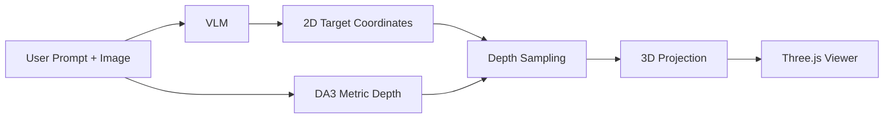

# Apollo Spatial VLM


A VLM picks targets in an image, Depth Anything 3 estimates metric depth, and the demo lifts the targets into a 3D point cloud and Gaussian splats you can inspect in the browser.

## Origin

Apollo Spatial VLM started as a fork of [MercuriusTech/Odyseus-Spatial-VLM](https://github.com/MercuriusTech/Odyseus-Spatial-VLM), a demo by Mercurius Technologies for their Odyseus spatial-intelligence product, and was renamed on 2026-10-14. The `upstream` git remote still points to that repository. Mercurius hosts their own live demo at [app.odyseus.xyz](https://app.odyseus.xyz).

From the original README:

> I've been recently fascinated by the possibilites provided by recent advancements in monocular depth estimation models and decided to expeirment combining them with a capable VLM, so below is an example demo to get 3D outputs from a VLM that can be more useful for a physical AI agent.

## Setup

Requires [uv](https://docs.astral.sh/uv/getting-started/installation/). No conda needed. Supported: Linux with an NVIDIA GPU (including Jetson), and macOS on Apple Silicon (depth on MPS, VLM via Ollama).

```bash
git clone --recurse-submodules https://github.com/mraad/Apollo-Spatial-VLM.git
cd Apollo-Spatial-VLM
```

`Depth-Anything-3/` tracks the upstream project as a submodule; `./setup.sh` fetches it if you cloned without `--recurse-submodules`.

Set up the depth demo environment (`.venv`):

```bash
./setup.sh
```

`TORCH_BACKEND=auto` (default) picks the PyTorch build that matches your NVIDIA driver, or the CPU/MPS build. Override with e.g. `TORCH_BACKEND=cu128 ./setup.sh`.

Set up the VLM environment (`.venv-vlm`, Linux + NVIDIA only):

```bash
./setup-vlm.sh
```

This installs vLLM and writes `.env.vlm` (VLM URL, model, GPU memory share, context length).

### Linux aarch64 (Jetson)

`pycolmap` (needed by Depth-Anything-3) has no wheel for Linux aarch64. Build [COLMAP](https://github.com/colmap/colmap) from source with CUDA and GUI off, install it, then install pycolmap from the COLMAP repo root and re-run `./setup.sh`:

```bash
CMAKE_PREFIX_PATH=<colmap install prefix> uv pip install --python .venv <path to colmap repo>
```

On Jetson the GPU shares memory with the CPU, so lower `GPU_UTIL` in `.env.vlm` (0.5 works on a 64 GB AGX Orin).

## Run

Start the VLM server (Linux, runs in a tmux session):

```bash
./run-vlm.sh
```

vLLM runs with CUDA graphs: on an RTX PRO 6000 server that made requests 26–27% faster for the cost of a longer first start (~166 s, then ~65 s once kernels are cached). On a Jetson the gain is ~2% and startup doubles, so set `ENFORCE_EAGER=1` in `.env.vlm` there.

The default VLM is `Qwen/Qwen3-VL-8B-Instruct`, which fits on a Jetson AGX Orin. On a GPU with room for about 56 GB of weights, set `VLM_MODEL=Qwen/Qwen3.6-27B` in `.env.vlm`: it follows the demo's output format far more reliably (see [`eval/README.md`](eval/README.md)).

On macOS, serve the VLM with [Ollama](https://ollama.com) instead and point the demo at it:

```bash
ollama pull qwen3-vl:8b-instruct
export QWEN_URL=http://127.0.0.1:11434/v1 VLM_MODEL=qwen3-vl:8b-instruct
```

### Choosing models

The page has a **Depth model** and a **VLM** dropdown; the server lists only what it can run (`GET /api/models`).

- Depth: Depth Anything 3 (`DA3METRIC-LARGE`, everywhere) and MoGe-3 ViT-L / ViT-G (Linux + NVIDIA). MoGe-3 estimates the field of view and gave better metric depth in [`eval/README.md`](eval/README.md). Install it with `WITH_MOGE=1 ./setup.sh`; pick the default with `DEPTH_MODEL=moge3-l ./run.sh`.
- VLM: one endpoint by default (`QWEN_URL` / `VLM_MODEL`). For several, set `VLM_MODELS=name=url,name=url` (the name is the model name the server serves), e.g. `VLM_MODELS=qwen3.6-27b=http://127.0.0.1:8014/v1,molmo2-8b=http://127.0.0.1:8013/v1 ./run.sh`, with each served by `eval/serve.sh`. Molmo2 models (name contains "molmo") are asked once per target ("Point to …").

What runs where (measured on the Sydney sample with a three-target prompt):

| Machine | Depth | VLM | Time per request |
|---|---|---|---|
| 4 × RTX PRO 6000 | any | Qwen3.6-27B / Qwen3-VL-32B / Molmo2-8B | ~4 s Qwen, ~1.5 s Molmo2 |
| Jetson AGX Orin 64 GB | DA3 / MoGe-3 L | Molmo2-8B (`--gpu-memory-utilization 0.5`) | 5 s (DA3), 9 s (MoGe-3 L) |
| Jetson AGX Orin 64 GB | DA3 | Qwen3.6-27B-FP8 (`0.7`, emulated FP8) | 16 s |
| Mac (Apple silicon) | DA3 | Ollama `qwen3-vl:8b-instruct` | ~1.5–10 s |

On Jetson keep Hugging Face downloads on the NVMe (`HF_HUB_CACHE=/data/hf-hub`); the eMMC root disk is small.

Start the depth demo (uses CUDA, then MPS, then CPU, whichever is available):

```bash
./run.sh
```

Then open:

```text
http://localhost:8080
```

## Use

1. Upload an image.
2. Enter a prompt like `select the chair near the desk and the closest door`.
3. Click `Run Demo`.
4. Inspect:
   - the 2D target overlay
   - the 3D point cloud
   - labeled 3D targets
   - the camera frustum and guide vectors

## Flow



## Notes

- Runs on Linux + NVIDIA (tested on Jetson AGX Orin) and macOS on Apple Silicon.
- PowerShell / Windows setup help is welcome. Contributions for improving `setup-vlm.ps1` or adding fuller Windows support are encouraged.
