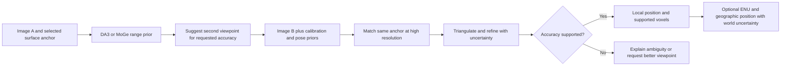

# Locating a surface point from two images

Research branch: `research/two-view-localization`. Investigated 2026-10-15 against Apollo 0.2.1 and DA3 submodule `41736238f5bced4debf3f2a12375d2466874866d`.

**Design target: 10 cm positional error at 5–20 m.** Treat this as a proposed 95th-percentile **3D point error**, and report local-camera and absolute-world accuracy separately. The experiments below establish a baseline; they do not yet demonstrate this target across that range.

## Recommendation

Build a two-image measurement mode: use DA3 or MoGe to understand the scene and suggest a second viewpoint, match the **same physical surface point** at high resolution, then triangulate with calibrated cameras. Return a position, an uncertainty ellipsoid and the observations that support it. Add GPS georeferencing only when the world-frame position and orientation are sufficiently constrained.

For a calibrated stereo pair, compare **FoundationStereo** against the inexpensive OpenCV baseline implemented here. For arbitrary viewpoints, evaluate **DA3's any-view models** and **MapAnything**. A larger single-image model alone cannot establish a 10 cm accuracy guarantee.

The proposed Apollo feature is **accuracy-directed capture**: the user chooses a target and a tolerance; the system recommends where to take the second image, then accepts or declines the measurement based on calibrated uncertainty. Triangulation, learned matching, bundle adjustment and active viewpoint selection already exist. This is a new workflow for this application, not a claim of a new scientific invention.

## What changes when there are two cameras?

| Available information | What it establishes | What remains uncertain |
|---|---|---|
| One image + a metric depth model | A learned estimate of distance and shape | Scene-dependent scale/bias and individual-point errors |
| Two overlapping images + calibrated intrinsics | Relative rotation, translation direction and triangulated shape in nondegenerate scenes | Metric scale and absolute world frame |
| Above + measured distance between camera centres | Metric scale | Global position/orientation; pose and matching errors |
| Full relative pose (rotation + translation in metres) | Metric triangulation in a camera/rig frame | Absolute geographic placement |
| Two camera GPS positions + visual reconstruction | Baseline scale and world baseline direction | Rotation about that baseline is still undetermined |
| Above + reliable gravity direction not parallel to the baseline, or a surveyed attitude/control geometry | A constrained world-frame alignment | Sensor/calibration uncertainty and shared biases |

"Relative position" must distinguish a baseline length, a displacement vector and a full six-degree-of-freedom pose. Two photographs taken by moving one camera can work for a static scene. Rotating a camera in place adds no triangulation baseline. Forward motion gives little parallax for points near the direction of travel; lateral motion usually helps more. Increasing separation eventually hurts overlap, matching and visibility.

Two GPS camera centres do not determine a unique 3D rotation: rotating the reconstructed scene around the line through those centres leaves both positions unchanged. A third **noncollinear** camera centre can remove this ambiguity; a third point on the same flight line cannot. COLMAP's general geo-registration consequently requests at least three camera locations. [COLMAP geo-registration](https://colmap.github.io/faq.html#geo-registration).

## The measurement geometry

Use calibrated pinhole intrinsics `K`, distortion parameters, and OpenCV world-to-camera poses `[R | t]`:

```text
camera centre C = -Rᵀ t
world ray r = normalize(Rᵀ K⁻¹ [u, v, 1]ᵀ)
point X = C₀ + λ₀r₀ ≈ C₁ + λ₁r₁
```

Find `X` by triangulation, then refine reprojection error with robust weights. Reject negative depth, almost parallel rays, inconsistent matches and excessive reprojection residuals. OpenCV supplies calibration, undistortion, rectification and triangulation primitives. [OpenCV calibration and 3D reconstruction](https://docs.opencv.org/4.13.0/d9/d0c/group__calib3d.html).

For rectified cameras with equal principal points, depth `Z = fB/d`, where `B` is baseline in metres, `f` is focal length in pixels **at the matching resolution**, and `d` is disparity in pixels. Different principal points require the offset: `Z = fB / (d + cx₁ − cx₀)`. This is used in the public-data experiment. [Middlebury calibration convention](https://vision.middlebury.edu/stereo/data/scenes2014/).

Approximate depth uncertainty for small, independent errors near the optical axis:

```text
σd = √(σu₀² + σu₁²)
σZ,pixels ≈ Z² σd / (f B)
σZ,baseline ≈ Z σB / B
σZ,relative-yaw ≈ Z² σθ,relative / B     (radians)
σZ,focal ≈ Z σf / f
world lateral error from global attitude ≈ Z σθ,global
```

Relative camera rotation error changes triangulated depth; an error in the whole rig's world orientation rotates otherwise correct local geometry. They are different error terms. These approximations break down near zero disparity, with large uncertainty, or for very wide/convergent views; use the full projection Jacobians or Monte Carlo there.

### What the synthetic experiment says

The reproducible experiment uses 10,000 trials per case, independent Gaussian 0.5-pixel noise in each image coordinate, focal length 1500 px, and **exact calibration/poses**. These are assumed noise levels, not measured DA3 performance. Depth errors below are computed before the geometry acceptance gate.

| Range | 0.2 m baseline: 95th-percentile depth error | 1 m baseline | 5 m baseline |
|---|---|---|---|
| 5 m | 11.5 cm | 2.3 cm | 0.5 cm |
| 10 m | 46.4 cm | 9.3 cm | 1.8 cm |
| 20 m | 187.3 cm | 37.2 cm | 7.4 cm |
| 50–100 m | See full results; errors grow rapidly | Metres | Still strongly range-dependent |

A 1 m baseline at 10 m is promising for the depth component, but leaves almost no budget for calibration or georeferencing errors. At 20 m, the same images need more baseline, more effective focal pixels, better matching, or a combination. A 5 m baseline at only 5 m range also changes viewpoint substantially; the synthetic test assumes correspondence survives.

### A plausible capture specification to test

For the difficult 20 m end, start with a roughly **2 m lateral baseline**, calibrated lenses, retained high-resolution images, and local feature refinement around each target. The following is an **engineering error budget**, not an achieved specification:

| Assumed one-sigma error | Example contribution at 20 m, 2 m baseline |
|---|---|
| 0.2 px per image, `f = 3000 px` | 1.89 cm depth |
| 0.005° relative rotation | 1.75 cm depth |
| 1 mm baseline error | 1.00 cm depth |
| 0.05% focal-length error | 1.00 cm depth |

Independent quadrature gives about 2.93 cm depth sigma. This leaves little budget for additional bias or absolute positioning. These tight pose tolerances favour a calibrated rigid setup or surveyed camera poses; they are not a promise for two casually GPS-tagged phone photographs. Recalibrate after focus/zoom changes and account for lens distortion, rolling shutter and timing.

Do not reuse the app's 384-pixel VLM input or 504-pixel depth output as the precision measurement. Keep that coarse image for object selection, then refine a feature/corner/patch correspondence at original resolution. At the same field of view, downsampling also reduces focal length in pixels and therefore depth precision.

## GPS, EXIF and height above ground

**Accurate GPS helps absolute placement and sometimes scale; it does not replace a second ray or camera orientation.** Treat GPS as a measured prior with uncertainty. A shared GPS offset moves the whole reconstruction and cannot be removed by averaging thousands of scene points. Relative baseline errors can be much smaller than absolute position errors when common GNSS errors cancel, so preserve their correlation instead of assuming two independent fixes.

Store latitude/longitude together with a height reference, timestamp, accuracy/covariance and measurement source. Compute in a local ENU frame, using double precision for geodetic/ECEF coordinates. Apply the antenna-to-camera lever arm using the measured attitude; the GPS antenna is not the camera's optical centre. Camera attitude must include the sensor/gimbal/body transform and distinguish true from magnetic heading.

Height above ground (AGL) is **not** ellipsoidal height and is **not** automatically the EXIF GPS altitude. If the terrain elevation is orthometric `Hground`, then approximately `Hcamera = Hground + AGL`; conversion to ellipsoidal height requires the matching geoid separation, `h = H + N`. All quantities must use compatible horizontal/vertical datums and the same ground reference. A drone's takeoff-relative altitude also differs from terrain-following AGL. [NOAA height relationship](https://www.ngs.noaa.gov/PUBS_LIB/gislis96.html).

Accurate AGL plus known attitude and a valid ground plane/DEM can constrain a ray's intersection with the ground. This helps ground-contact targets and can constrain scale; it does not determine the height of an arbitrary object or make an incorrect ground plane true. Near-horizontal rays are particularly sensitive to terrain and pitch error.

Full lens calibration beats EXIF focal length alone: EXIF does not supply reliable distortion, principal point, full attitude or a guaranteed position covariance. A correct focal length improves projection but does not eliminate learned depth bias.

## Model choices worth testing

Capabilities and checkpoint notes checked against the authors' sources on 2026-10-15. This is a shortlist by fit to the task, not a new comparative accuracy benchmark.

| Candidate | Role in Apollo | Decision |
|---|---|---|
| Current `DA3METRIC-LARGE` | Single-image metric estimate | Keep as baseline/prior; not the multi-view DA3 variant |
| `DA3-LARGE-1.1`, or `DA3-BASE` | Joint depth/pose and pose-conditioned inference | Closest extension to the bundled code. Large 1.1 is a research checkpoint; Base is Apache 2.0 |
| `DA3NESTED-GIANT-LARGE-1.1` | Joint geometry plus a learned metric scale | Compare when baseline is unknown; measured scale is preferable when available |
| MapAnything | Joint metric reconstruction with optional intrinsics, poses and depth | Strong alternative for heterogeneous calibration inputs; evaluate `facebook/map-anything-apache` too |
| FoundationStereo / Fast-FoundationStereo | Dense correspondence on undistorted, rectified stereo | Preferred learned candidates for a calibrated rig; test accuracy first, then Orin speed |
| MASt3R | Matching across more different viewpoints | Candidate for arbitrary image pairs and difficult correspondences |
| VGGT / VGGT-Ω | Multi-view geometry and pose initialization | Useful comparison; use the updated September 2026 Ω reference checkpoint for new experiments |
| MoGe-3 L | Monocular geometry/FOV prior already integrated here | Existing DIODE results beat this app's DA3 metric baseline, but do not establish two-view or 10 cm accuracy |

DA3 distinguishes metric-monocular and any-view models; its authors recommend the refreshed `-1.1` checkpoints. Large/Giant/Nested checkpoints have noncommercial terms, unlike Base/Small and the current metric model. [DA3 model cards](https://github.com/ByteDance-Seed/Depth-Anything-3#-model-cards).

MapAnything accepts camera-to-world OpenCV poses with an explicit metric-scale flag, unlike DA3's world-to-camera convention. Its Apache and noncommercial model variants share an API. [MapAnything inputs and models](https://github.com/facebookresearch/map-anything).

FoundationStereo requires rectified, undistorted image pairs and known intrinsics/baseline for metric output. Its authors provide Jetson instructions. Fast-FoundationStereo trades some offline accuracy for speed; reported desktop timings do not establish performance on our Orin. Research and commercial distributions have different terms. [FoundationStereo](https://github.com/NVlabs/FoundationStereo), [Fast-FoundationStereo](https://github.com/NVlabs/Fast-FoundationStereo).

MASt3R explicitly couples geometry with correspondence; its repository/checkpoints have noncommercial restrictions. VGGT's checkpoint terms also vary. VGGT-Ω's project asks new comparisons to use its replacement reference checkpoint. [MASt3R](https://github.com/naver/mast3r), [VGGT](https://github.com/facebookresearch/vggt), [VGGT-Ω](https://vggt-omega.github.io/). MoGe is a single-image geometry model; the repository's own [DIODE evaluation](../eval/README.md#depth-metric-depth-against-laser-ground-truth) is the relevant evidence for our existing integration. [MoGe authors' repository](https://github.com/microsoft/MoGe).

### A specific DA3 two-view integration problem

The pinned API accepts `extrinsics`, `intrinsics` and `align_to_input_ext_scale=True`, and passes normalized poses to the network. However, afterward `_align_to_input_extrinsics_intrinsics` calls `align_poses_umeyama`, which delegates to `evo` camera-centre alignment. With just two camera centres, that alignment is rank deficient. A minimal invocation of the same dependency failed locally with `GeometryException: Degenerate covariance rank, Umeyama alignment is not possible`.

This is a reproduced **alignment-layer** failure, not a two-image neural inference benchmark. Setting `align_to_input_ext_scale=False` does not avoid the call: alignment runs before that flag is checked. See [the bundled API](../Depth-Anything-3/src/depth_anything_3/api.py) and [alignment helper](../Depth-Anything-3/src/depth_anything_3/utils/pose_align.py).

A DA3 integration needs an explicitly tested two-view adapter: preserve both input intrinsics/poses, use the known-to-predicted camera-baseline ratio for depth scale, and use supplied rotations for the frame rather than estimating a 3D similarity from two centres. Reject zero/unstable predicted baseline. The metric-monocular `f/300` correction must not be applied blindly to any-view or already-metric outputs. No submodule changes or inference adapter are included in this branch.

## Proposed Apollo flow



1. **Choose the measurement.** A VLM finds the object; the user or a feature matcher pins a repeatable visible surface anchor. Two independent VLM "object centres" may refer to different surfaces and must not be treated as a stereo correspondence. An object's hidden volume centre cannot be inferred accurately from two visible points.
2. **Plan the second view.** Use a conservative depth range from DA3/MoGe and candidate lateral camera locations. Project the target into the proposed view, estimate overlap/occlusion risk, and propagate the sensor/matching error budget. Recommend a location that reduces the largest uncertainty direction. For the rectified approximation, `B >= 1.96 Z² σd / (f εz)` is a starting point for a 95% depth tolerance, not a complete 3D/world guarantee.
3. **Establish camera geometry.** Use calibrated poses when available; otherwise estimate/refine pose from many background matches with robust estimation and pose priors. Keep calibrated intrinsics fixed initially. Treat GPS and IMU as uncertain observations, not exact ground truth. Use synchronized images for moving scenes or explicitly limit the mode to static targets/scenes.
4. **Match and measure.** Refine the target patch at high resolution; enforce epipolar and bidirectional checks, visibility, sufficient parallax and consistency with nearby surface features. Run triangulation and robust reprojection refinement. A DA3/MoGe estimate may guide correspondence search or flag disagreement, but must not be counted as independent corroborating evidence when it derives from the same images.
5. **Return calibrated uncertainty.** Propagate matching, lens, relative pose and georeferencing uncertainty jointly. If pose was estimated from the same matches, keep their covariance/coupling; naïvely adding independent terms is optimistic. A joint optimization can marginalize camera parameters with a Schur complement. Validate claimed coverage on held-out surveyed targets. Neural confidence is not automatically a probability or a metre-valued uncertainty. Repeated patterns can produce several plausible matches: preserve multiple hypotheses or decline the measurement instead of averaging them into a point between surfaces. A single ellipsoid is suitable only after resolving that ambiguity.
6. **Assign voxels only after measurement.** Keep a floating-point point estimate and 3×3 covariance in the local frame. For a fixed origin and cell width `s`, use `floor((X-origin)/s)`. A 10 cm cell is a storage choice, not a 10 cm accuracy claim. Report neighbouring cells/unknown if the confidence region crosses boundaries; do not fill unseen interiors. A Gaussian 95% 3D ellipsoid uses `δᵀΣ⁻¹δ <= 7.815`; a conservative bounding radius is `2.795 sqrt(λmax(Σ))`, not `1.96σ`.

The output should distinguish **local measured**, **world georeferenced**, **prior-only estimate**, and **unresolved**. Show the paired image patches, reprojection/parallax diagnostics, an ellipsoid and local/world error bounds alongside a target label. A failed world-accuracy requirement should not discard a useful local measurement.

## Public stereo experiment: what actually worked

The new [experiment](../eval/two_view_localization.py) runs on CPU with existing NumPy/OpenCV dependencies. It uses the Middlebury 2014 `Motorcycle-perfect` pair, published calibration and ground-truth disparity. Images and GT are sampled at every fourth pixel, yielding 741×500; intrinsics and disparities scale accordingly. The 0.193001 m baseline and differing principal points are retained. SGBM produces correspondences; left-right consistency, positive depth, a 0.1° minimum ray angle and at most 1 px reprojection residual determine acceptance. Ground truth is used **only after acceptance**, for scoring.

| Metric | Result |
|---|---|
| Ground-truth pixels evaluated for coverage | 360,024 |
| Accepted pixels with ground truth | 271,232 (75.34%) |
| Ground-truth depth 5th–95th percentile | 2.22–4.66 m |
| Median 3D point error, accepted pixels | 0.74 cm |
| 95th-percentile 3D point error, accepted pixels | **11.90 cm** |
| Accepted points within 10 cm | 94.64% |
| All GT-valid pixels both accepted and within 10 cm | 71.30% |

The ordinary stereo baseline is promising, but **does not meet the proposed 95%/10 cm criterion**, even on this mostly closer scene. Median error alone would hide that failure. This is one static indoor scene with excellent calibration, not a representative 5–20 m outdoor evaluation or evidence that any learned model wins. A test also demonstrates that a wrong match along the correct epipolar line can have zero reprojection error and still produce the wrong depth. Geometry gates alone do not prove correspondence correctness.

The [JSON results](../eval/results/two-view-localization.json) include input hashes, parameters, software versions and synthetic results. Source images/GT stay under ignored `eval/data/`. The PFM reader follows Middlebury's special convention: scale **magnitude is ignored**, sign selects endianness, rows are bottom-up and values are raw pixel disparities. [Middlebury PFM instructions](https://vision.middlebury.edu/stereo/submit3/upload-format.html).

### Reproduce

From the repository root, after the existing demo environment is installed:

```bash
scene_dir=eval/data/two-view/Motorcycle-perfect
mkdir -p "$scene_dir"
for name in calib.txt im0.png im1.png disp0.pfm; do
  curl -fL --output "$scene_dir/$name" \
    "https://vision.middlebury.edu/stereo/data/scenes2014/datasets/Motorcycle-perfect/$name"
done
.venv/bin/python -m unittest discover -s tests -p 'test_two_view_localization.py' -v
.venv/bin/python eval/two_view_localization.py --middlebury "$scene_dir"
```

Omit `--middlebury` for synthetic geometry only; use `--output /tmp/two-view-synthetic.json` to avoid replacing the combined saved result.

Reproduce the DA3 alignment dependency failure without importing the model:

```bash
.venv/bin/python - <<'PY'
import numpy as np
from evo.core.trajectory import PosePath3D
poses = np.repeat(np.eye(4)[None], 2, axis=0)
poses[1, 0, 3] = 1.0
try:
    PosePath3D(poses_se3=poses.copy()).align(
        PosePath3D(poses_se3=poses.copy()), correct_scale=True)
except Exception as error:
    print(type(error).__name__, str(error))
PY
```

## Next experiment and integration boundary

First collect or select independently calibrated/surveyed targets at 5, 10 and 20 m, with 0.2, 1 and 2 m baselines and some convergent views. Include textureless walls, repeated patterns, vegetation, thin objects, shiny surfaces and partial occlusion. A larger public stereo benchmark can assess correspondence generalization; absolute GPS accuracy needs separate world-frame control data.

Compare SGBM, FoundationStereo, DA3 any-view with the two-view adapter, and MapAnything on exactly the same pairs and held-out targets. Include the current DA3 metric and MoGe-3 L single-image estimates as baselines. Lock thresholds before held-out evaluation, perturb calibration/pose inputs, and report accepted coverage, 95th-percentile 3D error, false-accept rate, uncertainty coverage, local versus world error, runtime and memory. Do not perform an unconstrained similarity alignment to ground truth before reporting metric/geographic accuracy.

Promote a method only when at least 95% of accepted targets are within 10 cm on held-out data, while reporting how many targets it rejects and confidence intervals for the success rate. Test uncertainty calibration separately: an ellipsoid labelled 95% should contain ground truth at the advertised rate. A second objective is whether guided second-view selection achieves the same accuracy with fewer rejected captures than unguided pairs.

Production work would touch `demo.py` (a separate paired-image endpoint and calibration validation), `index.html`/`index.js` (paired observations, capture guidance and uncertainty display), configuration/model loading, and integration tests. Keep raw geometry in float32/64; the current float16 display payload must not become the precision triangulation input. The current `project_target_to_3d` median 11×11 single-depth patch is not the paired-point measurement path.

This research branch adds the experiment, focused tests, saved results and this proposal. It does not change application behaviour, run learned stereo/multi-view models, validate GNSS/AGL sensors, or start local/gc1/Orin services.
